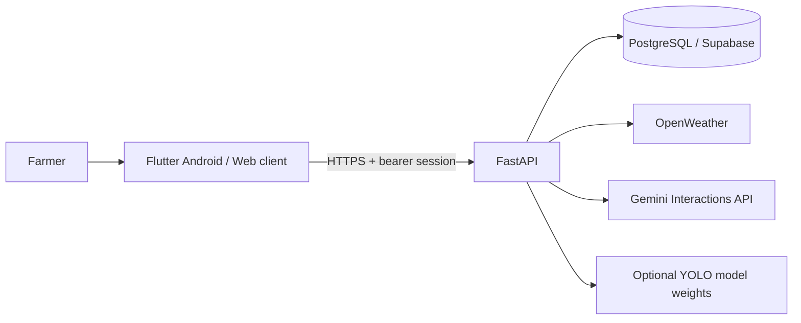

# AgriVerse AI

Community-oriented agricultural support for farmers. The repository keeps the requested three-folder structure: Flutter client, FastAPI backend, and PostgreSQL/Supabase database scripts.

## Architecture



## Folder structure

```text
AgriVerseAI/
├── frontend/   Flutter and Dart application
├── backend/    FastAPI, persistence, provider adapters, tests
├── database/   PostgreSQL schema and ordered SQL migrations
├── README.md
└── .gitignore
```

## Implementation status

| Area | Current implementation |
| --- | --- |
| Account access | Backend password registration/login, JWT sessions, secure token storage, profile/preferences API |
| Farms | Authenticated Flutter create/read/update/delete with farmer ownership checks |
| Crop cycles and observations | Authenticated Flutter create/list/details/edit/delete cycle flow and dated observation create/list/edit/delete history; backend ownership, date/value validation, persistence, and pagination are covered by tests |
| Crop screening | Explicit inputs and transparent, limited rule-based screening; no confidence score or scientific accuracy claim |
| Weather | Configurable OpenWeather geocoding, current observation, and provider forecast; missing credentials/errors are shown as unavailable |
| Irrigation | Authenticated field-assessment guidance; no unsupported water quantities |
| Yield and profit | Persisted arithmetic estimate from farmer-entered yield, price, and costs; no yield model or market feed |
| Disease screening | Validated in-memory image upload and YOLO adapter; no trained weights or verified class allow-list are present, so real diagnosis remains unavailable |
| Farming assistant | Configurable Gemini Interactions API and private persisted conversations; current configured credential was rejected during a live check; no trusted RAG corpus is configured |
| History | Farmer-scoped yield, assistant conversation, diagnosis, crop-cycle, and field-observation history are available through the app and owner-scoped APIs |

These are implementation descriptions; refer to the latest test/build results and manual setup status before deployment. No production database migration or external deployment is performed by this repository setup.

## Technology and prerequisites

- Python 3.11+ recommended, `pip`, and PostgreSQL 15+ or Supabase PostgreSQL.
- Flutter and Dart SDK compatible with the SDK constraint in `frontend/pubspec.yaml`, Android SDK/JDK 17 for Android builds.
- Optional provider accounts: OpenWeather and Gemini. Optional YOLO weights compatible with the configured model runtime.

Keep provider/database credentials on the backend. Never place private keys or database URLs in Dart code, Flutter `--dart-define`, source control, or client builds. Flutter's `API_BASE_URL` is an endpoint URL, not a secret.

## Environment configuration

### Backend

Copy `backend/.env.example` to `backend/.env`, then set values for the selected environment:

| Variable | Required | Purpose |
| --- | --- | --- |
| `ENVIRONMENT` | Production | Set to `production` for release service |
| `DEBUG` | Production | Must be `false` outside development |
| `SECRET_KEY` | Yes | Generate a private random key of at least 32 bytes |
| `DATABASE_URL` | Production | PostgreSQL/Supabase direct connection URL; leave empty only for local SQLite development |
| `CORS_ORIGINS` | Production | JSON array of exact trusted web origins; Android native clients do not use browser CORS |
| `TRUSTED_HOSTS` | Production | JSON array of exact public API hostnames; never use `*` |
| `WEATHER_API_KEY` | Weather | OpenWeather provider key; empty disables weather and returns a clear unavailable response |
| `GEMINI_AI_API_KEY` | Assistant | Gemini API key; empty disables assistant responses |
| `GEMINI_MODEL` | Assistant | Provider model identifier enabled for the account |
| `DISEASE_MODEL_PATH` | Disease screening | Backend filesystem path to trained YOLO weights; empty disables diagnosis |
| `DISEASE_MODEL_CONFIDENCE` | Optional | Confidence threshold from 0 to 1 |
| `DISEASE_ALLOWED_LABELS` | Disease screening | JSON array of exact disease class names supported by the deployed model; unmapped classes remain uncertain |
| `MAX_UPLOAD_BYTES` | Optional | Per-image upload limit |
| `MAX_REQUEST_BYTES` | Optional | Request body limit |

Generate a key locally, without printing it into project files:

```powershell
python -c "import secrets; print(secrets.token_urlsafe(48))"
```

The existing local `backend/.env` and SQLite database are machine-local inputs and are ignored by Git. They were not copied into documentation or used by the automated test database.

### Flutter

`frontend/.env.example` documents the endpoint but Flutter does not load `.env` files. Configure it at compile/run time:

```text
--dart-define=API_BASE_URL=http://10.0.2.2:8000/api/v1
```

Use `http://localhost:8000/api/v1` for desktop/web local development. Use an HTTPS URL for release builds.

## Database setup and migration

The backend does not run `create_all` on PostgreSQL and does not reset or seed a configured database. It only initializes a local SQLite development database. PostgreSQL schema changes are reviewed SQL scripts in `database/migrations/`.

1. Confirm the connection target from the production secret manager without printing the URL. Take a provider snapshot or a custom-format `pg_dump` backup in encrypted storage and verify that `pg_restore --list` can read it; perform a restore rehearsal in an isolated staging database.
2. For a fresh database, apply migrations `001` through `010` in numerical order.
3. For a database that has applied `001` through `009`, apply only `010_farm_observation_updated_at.sql`. For a database at `001` through `008`, review/apply `009_private_data_policies_and_estimate_ownership.sql`, then apply migration `010`.
4. Verify RLS policies and owner-scoped API behavior in a staging project before production.
5. Do not run `database/seed_data.sql` against production. It is development/demo data only.

Migration 009 adds nullable yield ownership fields, backfills ownership only where an existing farm/crop-cycle relationship proves it, removes an invented recommendation confidence default, changes the default diagnosis severity to `Uncertain`, tightens Supabase RLS, and recreates compatibility views as security-invoker views. Migration 010 adds `farm_observations.updated_at` with a default and update trigger. Both migrations are additive and preserve existing records. Neither has been applied to a live database from this workspace.

Before production migration, compare the database's applied migration list with files `001`–`010`, inspect unowned yield rows in staging, restore the backup into an isolated database, apply pending migrations there, and verify row counts/FKs/indexes/RLS and observation timestamp updates as both an owner and another user. Schedule production changes with a rollback/restore plan. A PowerShell backup example is `pg_dump --dbname=$env:AGRIVERSE_DATABASE_URL --format=custom --file=$env:AGRIVERSE_BACKUP_FILE`; validate the archive with `pg_restore --list $env:AGRIVERSE_BACKUP_FILE`. Set both variables through protected local/host configuration; never print or commit the connection URL. This workspace did not connect to or modify a live database.

`database/rls_policies.sql` mirrors the RLS/ownership hardening from migration 009 for installations following the cumulative schema path; the cumulative `schema.sql` includes the observation timestamp field/trigger. Do not apply both migration 009 and that mirror as separate steps. Do not combine the cumulative `schema.sql` path with already-applied numbered migrations.

## Backend installation and launch

PowerShell from the repository root:

```powershell
cd backend
py -m venv .venv
.\.venv\Scripts\Activate.ps1
python -m pip install -r requirements.txt
Copy-Item .env.example .env
# Edit .env with local values. PostgreSQL is optional for local SQLite development.
python -m uvicorn app.main:app --host 0.0.0.0 --port 8000
```

OpenAPI is served at `http://localhost:8000/api/v1/docs`. `/health/live` reports process liveness; `/health/ready` checks database readiness and reports whether optional providers/models are configured. A configured provider is not the same as a verified provider account.

Crop cycles use `GET /api/v1/crop-cycles/farm/{farm_id}?skip=0&limit=50`, `POST /api/v1/crop-cycles`, `PATCH /api/v1/crop-cycles/{cycle_id}`, and `DELETE /api/v1/crop-cycles/{cycle_id}`. Field observations use `GET` and `POST /api/v1/farm-observations/crop-cycle/{cycle_id}?skip=0&limit=50` and `PATCH`/`DELETE /api/v1/farm-observations/{observation_id}`. These routes validate inputs, paginate lists, persist records, and enforce ownership through the authenticated farmer. Deleting a cycle removes its observations by FK cascade; estimate records are retained with their cycle reference set to NULL.

For optional YOLO inference, install `python -m pip install -r requirements-ml.txt`, place compatible trained YOLO weights in private backend storage outside the repository, and set `DISEASE_MODEL_PATH` to their absolute path. Set `DISEASE_ALLOWED_LABELS` to a JSON array of exact class names verified against that model's training metadata (for example, `["verified-class-from-model"]`; do not copy this example as a label). Restart the backend, confirm `/health/ready` reports `disease_model_configured: true`, then run a reviewed known-image inference test before enabling farmer access. Unknown or unmapped model classes remain uncertain. No weights or disease label mapping are bundled.

For the PlantVillage YOLO classification workflow, including safe Kaggle download, leakage-safe 80:20 split preparation, training, and model-derived runtime labels, see `backend/CROP_DISEASE_SETUP.md`.

## Frontend installation and launch

```powershell
cd frontend
flutter pub get
flutter run --dart-define=API_BASE_URL=http://10.0.2.2:8000/api/v1
```

The Android emulator uses `10.0.2.2` to reach the host machine. Development Android builds permit cleartext HTTP for local testing; release manifests deny cleartext traffic.

### Run the complete local stack

From the repository root, the PowerShell launcher starts the FastAPI backend, verifies the configured database connection, and then runs Flutter. It stops the backend when Flutter exits:

```powershell
powershell -ExecutionPolicy Bypass -File .\run-all.ps1
```

This opens the web app in Chrome. To run on an already-started Android emulator or connected Android device, use:

```powershell
powershell -ExecutionPolicy Bypass -File .\run-all.ps1 -Platform android
```

The launcher uses the PostgreSQL/Supabase connection configured in `backend/.env`; it does not start a separate database server. If `DATABASE_URL` is empty, the backend uses its local SQLite database instead.

## Testing and quality checks

```powershell
cd backend
python -m pytest -q
python -m compileall -q app

cd ..\frontend
dart format --output=none --set-exit-if-changed lib test
flutter analyze
flutter test
```

Backend automated tests use isolated SQLite and controlled provider/model mocks; they do not use the configured production database. Flutter tests exercise widget/state behavior and API request contracts with mocked HTTP. Live checks in this workspace reached OpenWeather and Gemini, but OpenWeather rejected the configured credential and Gemini returned Google `API_KEY_INVALID`; neither live provider flow is verified as working. There is no live PostgreSQL migration test.

## Android release build and signing

The Android application ID is currently `com.agriverse.frontend` and version is `1.0.0+1`; keep the application ID stable if upgrading an already-installed app. The release manifest has Internet access and disallows cleartext traffic. Release builds are not signed with the debug key.

1. Obtain the production HTTPS API base URL.
2. Create and securely back up a release keystore outside the repository. Never commit the keystore or passwords.
3. Set `ANDROID_KEYSTORE_PATH`, `ANDROID_KEYSTORE_PASSWORD`, `ANDROID_KEY_ALIAS`, and `ANDROID_KEY_PASSWORD` in the build environment using the absolute keystore path and values held in protected secret storage. The Gradle release configuration signs only when all four are present; otherwise the output is unsigned and must not be distributed.
4. Build an app bundle:

```powershell
cd frontend
flutter build appbundle --release `
  --dart-define=API_BASE_URL=https://api.example.com/api/v1
```

Run the command from PowerShell after loading the four signing variables from your secret manager. Do not put passwords in the command line, source files, `.env.example`, or the repository. Replace the example HTTPS host with the deployed backend URL.

For a sideload APK, use `flutter build apk --release` with the same HTTPS define. Replace `api.example.com` with the actual deployed service. Keep the keystore and its recovery copy in controlled secret storage.

## Backend deployment outline

Deploy `backend/` to a Python ASGI host with a persistent PostgreSQL connection and HTTPS termination. Install `requirements.txt`, inject the production variables above through the host's secret manager, apply reviewed migrations before routing traffic, and run:

```text
uvicorn app.main:app --host 0.0.0.0 --port $PORT
```

Configure the host to probe `/health/ready`, restrict database network access to the backend, retain encrypted backups, and set exact web CORS origins. Keep database/provider keys out of logs and mobile artifacts. This repository has no configured hosting account, DNS, deployment credentials, or production model file, so no live deployment is claimed.

### Container deployment

The backend includes a non-root production container. Before building it, apply the reviewed PostgreSQL migrations to a staging copy, verify the API with two farmer accounts, then apply only the pending migrations to production. The API will refuse to start against PostgreSQL when required tables are missing; it never creates PostgreSQL tables automatically.

1. Copy `backend/.env.production.example` to `backend/.env.production` outside source control and replace every placeholder through the deployment secret manager. Set `ENVIRONMENT=production`, a new `SECRET_KEY`, the PostgreSQL URL, exact HTTPS `CORS_ORIGINS`, and the exact public `TRUSTED_HOSTS` API hostname. Set `HEALTHCHECK_HOST` to a value in `TRUSTED_HOSTS` so the container health probe can pass host validation.
2. Build and start the API behind an HTTPS reverse proxy or managed load balancer. The compose file intentionally binds the API to `127.0.0.1:8000`; terminate TLS at the proxy and route health checks to `/health/ready`.

```powershell
docker compose -f compose.production.yml up --build -d
```

3. Build Flutter only with the public HTTPS API endpoint. Never ship `localhost`, `10.0.2.2`, database URLs, provider keys, or the backend `.env` file in a client build.

```powershell
cd frontend
flutter build web --release --dart-define=API_BASE_URL=https://api.example.com/api/v1
```

Use a CDN or HTTPS web host to publish `frontend/build/web`. For Android, use the equivalent HTTPS define with the release signing configuration described above. Configure host-level rate limiting, request-size limits, encrypted backups, monitoring, alerts, and log retention; the in-process API limits are not a replacement for edge protection.

## Known limits and troubleshooting

- If weather returns `WEATHER_NOT_CONFIGURED`, set a valid OpenWeather `WEATHER_API_KEY`; invalid credentials are reported as `WEATHER_PROVIDER_AUTH_FAILED`, and provider outages/rate limits return a sanitized error rather than sample weather.
- If assistant returns `ASSISTANT_NOT_CONFIGURED`, set a valid `GEMINI_AI_API_KEY` and verify account access to `GEMINI_MODEL`. Google key rejection, rate limits, timeouts, and unavailable models are returned as distinct safe error codes. The assistant has conversation memory but no trusted RAG source collection; it must not present answers as source-verified.
- When Gemini is configured, the backend sends the farmer's question, recent conversation, district/state, and a small set of soil, irrigation, and active crop fields to Google's API. It omits phone numbers and farmer names; provider-side `store=false` is set, while app conversation history is persisted in the configured database.
- If disease screening returns `DISEASE_MODEL_NOT_CONFIGURED`, install optional ML requirements and configure compatible trained weights. Images are not retained; only diagnosis metadata is saved.
- Crop screening uses a small transparent ruleset; it does not account for laboratory soil tests, local crop calendars, pests, variety, or market data.
- Yield/profit is arithmetic from entered yield, price, and cost values. No live price feed or yield model is configured.
- Static Flutter UI text is translated into English, Telugu, and Hindi. Provider generated answers depend on the configured model's actual language capability; Hindi output has not been live-verified in this workspace.
- Supabase custom-password accounts use the backend auth and a private backend database connection; the Flutter app does not receive Supabase service-role credentials.
- Review release branding, launcher artwork, Android signing, network URL, migration status, and provider accounts before store distribution.
- This checkout has no production backend URL or hosting credentials. Its current OpenWeather credential was rejected, Gemini reports `API_KEY_INVALID`, and no disease model/label set is installed. A signed release requires the user's release keystore and protected signing credentials.
